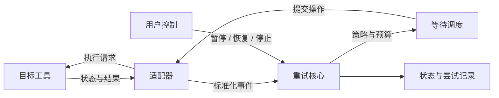

# Any Retry

**一个重试核心，连接不同工具。**

[设计思路](#设计思路) · [开发路线](#开发路线) · [参与开发](#参与开发) · [MIT License](LICENSE)

Any Retry 旨在为不同工具提供统一的自动重试能力：识别任务失败、决定重试时机、记录执行状态，并让用户随时暂停或停止。通用逻辑由核心负责，工具差异通过适配器接入。

> **项目进度：设计阶段。** 已完成总体方案与开发文档，下一步实现核心与模拟适配器，暂未提供可运行版本。

## 为什么做 Any Retry

任务遇到临时故障后，往往需要人工确认状态、等待，再发起一次执行。接入多个工具时，这套处理逻辑又容易被重复编写。

Any Retry 希望将这些共性能力集中起来，让新工具的接入重点落在三个问题上：**如何观察状态、如何提交操作、如何确认结果。**

## 规划能力

| 能力 | 解决的问题 |
| --- | --- |
| **统一接入** | 用适配器将不同工具的事件与操作转换为统一接口 |
| **灵活策略** | 按错误类型、重试次数和总时限决定是否继续，支持固定间隔与指数退避 |
| **执行控制** | 管理任务状态，支持暂停、恢复与停止 |
| **状态恢复** | 保存任务与尝试记录，重启后核对进度并恢复观察 |
| **过程追踪** | 记录每次重试的原因、等待时间与结果，便于排查问题 |

## 设计思路

项目围绕 **核心 + 适配器** 组织：适配器处理工具接入，核心统一管理状态、策略和调度。

一次重试的设计流程：

1. **观察**：适配器读取任务状态，将失败转换为标准事件。
2. **判断**：核心检查错误类型、剩余次数和时间预算。
3. **等待**：按策略安排重试，到期时再次核对任务与用户控制状态。
4. **执行**：记录尝试标识，由适配器提交操作并跟踪结果。

如果提交结果不明确，先查询状态或交由人工确认。协议字段、状态迁移与恢复规则见[总体开发指南](docs/PROJECT_GUIDE.md)。

## 开发路线

- [x] **P0 · 方案与文档** — 明确项目范围、架构、接口契约和验收标准。
- [ ] **P1 · 核心与模拟器** — 实现状态机、重试策略和模拟适配器，覆盖关键行为测试。
- [ ] **P2 · 本地运行** — 加入命令行控制、状态持久化和重启恢复。
- [ ] **P3 · 真实工具接入** — 完成首个适配器及端到端验收。
- [ ] **P4 · 扩展体验** — 接入更多工具，完善可视化控制台。

## 参与开发

从[总体开发指南](docs/PROJECT_GUIDE.md)开始，了解模块职责、数据契约与阶段验收要求。当前优先推进 **P1：数据模型、适配器协议和模拟器驱动的重试核心**。

| 入口 | 内容 |
| --- | --- |
| [开发指南](docs/PROJECT_GUIDE.md) | 架构、契约、实现顺序与验收标准 |
| [进度记录](docs/STATUS.md) | 已完成事项与待开发能力 |
| [Issues](https://github.com/YHonc/any-retry/issues) | 讨论接入需求、设计建议与问题 |

提出适配器需求时，请说明目标工具、典型失败场景、状态读取方式和重试操作。提交实现时，请附对应验证，并同步更新相关文档。

## 许可证与致谢

本项目采用 [MIT License](LICENSE)。

项目级分析技能使用 [Understand-Anything](https://github.com/Egonex-AI/Understand-Anything)，保留其原始版权与许可，详见[第三方说明](THIRD_PARTY_NOTICES.md)。
