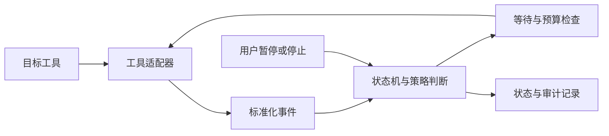

# Any Retry · 通用自动重试

面向不同工具的通用重试核心，通过适配器接入具体运行环境。目标是在任务发生**可识别、可安全重试的失败**后，按受限策略继续执行，并让每一次决策可追踪、可停止、可验证。

**[打开交互项目地图](https://YHonc.github.io/any-retry/map/)** · [开发指南](docs/PROJECT_GUIDE.md) · [真实进度](docs/STATUS.md) · [MIT 许可证](LICENSE)

地图由 **Understand-Anything** 生成并用其 Dashboard 展示，包含项目文档、设计概念、分层与阅读导览。它展示当前规划及证据边界，不代表重试引擎已经运行。

> **当前阶段：规划与文档初始化，尚不可作为重试工具运行。**
> 状态核验日期：2026-10-22。已有文档、项目级分析技能和地图构建工具；没有重试引擎源码、工具适配器、业务启动命令或业务测试套件。

## 目标

- 将失败识别、策略判断、等待调度、状态记录与具体工具接入分开。
- 通过统一适配器协议接入不同工具，避免为每个工具重新实现整套重试逻辑。
- 提供次数、时间和并发边界，支持暂停、停止及明确的失败终止原因。
- 对未知执行结果、人工介入和不可安全重复的操作停止自动处理。
- 区分“重试指令已提交”“目标工具执行成功”和“业务目标完成”。

“通用”指核心与接入层分离，不代表已经兼容任意工具，也不代表所有失败都应重试。

## 已实现与当前可用情况

| 内容 | 当前状态 | 当前可用程度 / 证据 |
| --- | --- | --- |
| 产品方向 | 已确认 | 通用重试核心，后续通过适配器接入不同工具 |
| 总体开发指南 | 已编写 | [开发指南](docs/PROJECT_GUIDE.md)，包含边界、拟定架构、契约及验收条件 |
| README | 已编写 | 本文件，可作为项目入口 |
| 本地文件排除规则 | 已配置 | [.gitignore](.gitignore)，用于排除运行数据和本地凭据文件 |
| Understand-Anything 项目级技能 | 已安装 | [.agents/skills/understand](.agents/skills/understand/SKILL.md)，固定上游版本，保留 MIT 版权 |
| 项目地图与导览 | 已生成 | [在线查看](https://YHonc.github.io/any-retry/map/)；[图谱 JSON](.ua/knowledge-graph.json)，内容为文档与设计 |
| 静态地图构建工具 | 已实现 | [维护说明](docs/MAP.md)，图谱校验与静态打包，不属于重试运行核心 |
| 重试核心、状态机、策略调度 | 未实现 | 无源码、无运行证据 |
| 适配器及模拟适配器 | 未实现 | 尚无已支持工具；首个真实适配器待选择 |
| CLI、控制台与持久化 | 未实现 | 无可用启动入口、界面或恢复能力 |
| 自动化测试与真实工具验收 | 未执行 | 尚无测试代码或端到端记录 |

**当前可用的是开发文档和项目地图，自动重试功能尚不可用。** 其他目录或历史项目中的工具未在本仓库迁入、审查和验证，不计入这里的实现进度。

## 先从地图理解项目

1. [打开交互地图](https://YHonc.github.io/any-retry/map/)，从导览开始，了解目标与当前阶段。
2. 点击节点查看摘要、关系及所在层；注意“已有文档”“待实现设计”等状态。
3. 回到 [开发指南](docs/PROJECT_GUIDE.md) 阅读契约与验收条件。

地图网页公开可读，不需要安装技能或提供 API Key。`.ua/knowledge-graph.json` 是可复用的图谱数据，`docs/map/` 是静态发布文件。GitHub 文件页只显示 HTML 源码，因此 README 链接指向 GitHub Pages。更新、局部安装和静态模式限制见 [地图维护说明](docs/MAP.md)。

## 实现原理

当前没有重试引擎运行代码。以下是**拟采用的重试设计原理**，实际实现完成后应补充源码入口和验证证据：

1. 适配器将工具事件归一化为运行中、成功、失败或需要人工处理等状态。
2. 核心检查任务身份、当前状态、重试预算、失败类型和重复执行风险。
3. 仅对明确允许重试的失败计算等待时间；到期后再次检查取消状态和工具状态。
4. 在提交前持久记录尝试标识，由适配器执行一次重试操作。
5. 接收结果并更新状态；无法确认提交结果时进入待确认状态，避免盲目重复提交。

上述图表示目标架构，不是已经存在的调用链。协议字段、状态迁移、异常处理和验收场景见[总体开发指南](docs/PROJECT_GUIDE.md)。

## 后续开发顺序

1. 定义数据模型、适配器协议和错误分类。
2. 用模拟适配器实现核心状态机与受限重试，完成确定性测试。
3. 增加本地持久化、重启恢复与命令行控制。
4. 选择一个真实工具，完成版本与接口核验，再实现适配器并做真实验收。
5. 核心稳定后再考虑图形控制台和更多适配器。

目前没有重试工具的安装或运行命令；地图工具的安装与构建命令单独放在 [地图维护说明](docs/MAP.md)。未来首次加入重试核心时，必须同步补齐依赖安装、启动、测试和停止方式。

## 开发文档

- [总体开发指南](docs/PROJECT_GUIDE.md)：范围、架构、数据与适配器契约、开发顺序、验收标准和维护规则。
- [开发进度与证据](docs/STATUS.md)：当前完成项、能力状态和后续验收记录要求。

更新功能时同时更新入口、指南与进度记录；仅有设计或配置时，不将对应功能标为已实现。

## 开源与致谢

本项目采用 [MIT License](LICENSE)。项目地图与分析技能基于 [Understand-Anything](https://github.com/Egonex-AI/Understand-Anything)，保留其原始版权与 MIT 许可；依赖声明见 [第三方说明](THIRD_PARTY_NOTICES.md)。
